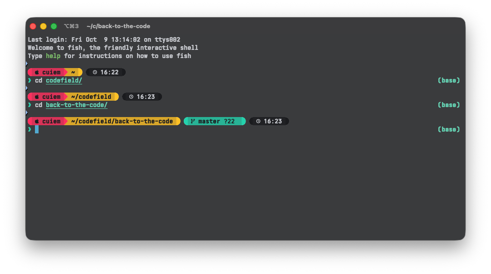
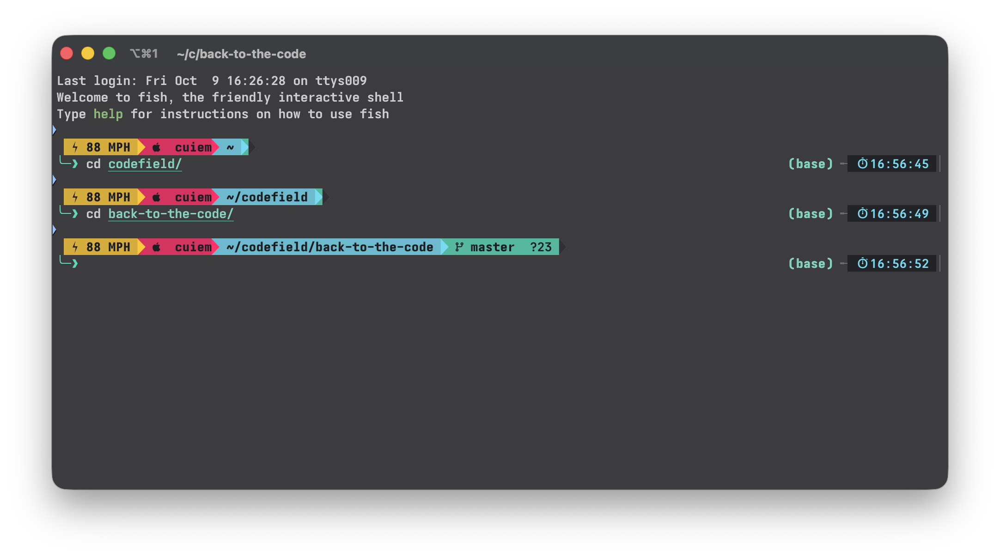
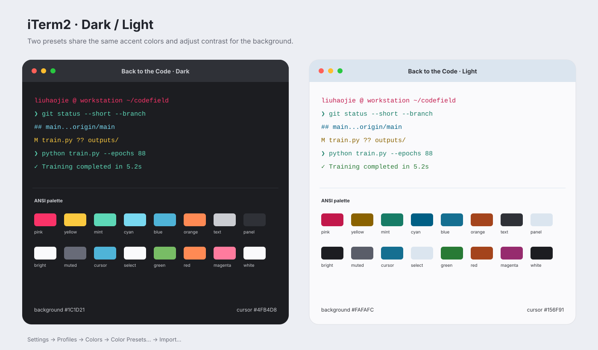
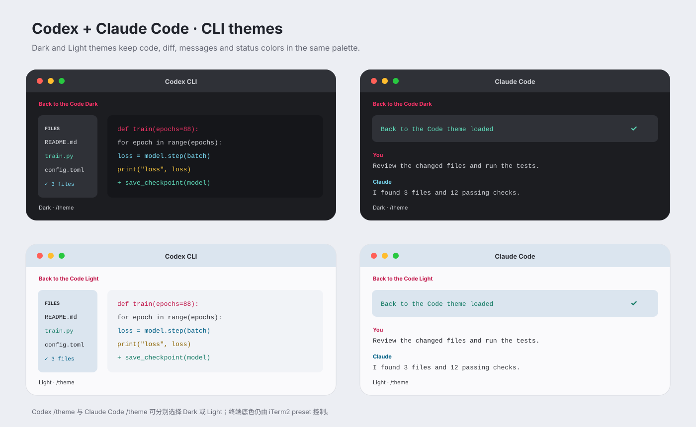

# Back to the Code Themes

一套统一的终端与 AI coding CLI 主题，基于 [divyanshu013/back-to-the-code](https://github.com/divyanshu013/back-to-the-code) 做了非官方适配：

本项目与原作者及原项目没有隶属或官方背书关系。原始配色和相关适配内容按原仓库的 MIT License 使用；发布或再分发时，请保留原作者版权声明和授权文本。

- 深灰底 `#1C1D21` / 冷白底 `#FAFAFC`
- 粉色 `#FA3368`、金黄 `#FBC93F`、青绿 `#5DD8B7`、浅青 `#79D9F1`
- 适配 Starship、iTerm2、Codex CLI 和 Claude Code
- Starship 提供两种布局：圆角胶囊 `round`，以及带系统图标和 `⚡88 MPH` 标记的尖角赛车 `sharp`

本文按 **Starship、iTerm2、Codex、Claude Code** 四个板块说明安装和切换方法。主题文件已经包含在本仓库中；安装命令默认在仓库根目录执行。

## 视觉预览

Starship、iTerm2、Codex 与 Claude Code 均展示实际或配套效果图，方便在安装前快速确认风格。

### Starship

**Round 实际运行效果**：粉色的系统/用户与黄色的目录连成一个胶囊，Git 状态和时间分别使用独立胶囊，第二行显示 `❯` 输入提示符。

**Sharp 实际运行效果**：包含 `⚡88 MPH`、系统/用户、目录、Git，以及右侧时间信息。

### iTerm2

### Codex 与 Claude Code

## 安装前准备

建议使用 macOS + iTerm2 + zsh。Starship 也可以在 Linux、bash 或 fish 中使用；Codex 和 Claude Code 需要先各自安装 CLI。

先进入项目目录，并确认四个主题目录存在：

~~~
cd /path/to/back-to-the-code
ls starship iterm2 codex claude
~~~

如果只想一次复制 Starship、Codex 和 Claude Code 的文件，可以运行安装脚本：

~~~
chmod +x ./install.sh

# 安装尖角赛车布局（默认）
./install.sh sharp

# 或安装圆角胶囊布局
./install.sh round
~~~

脚本会把 Starship 写入 `~/.config/starship.toml`，把 Codex 主题写入 `~/.codex/themes/`，把 Claude Code 主题写入 `~/.claude/themes/`。它不会安装 Starship、iTerm2、Codex CLI 或 Claude Code，也不会自动导入 iTerm2 配色；这几部分请按下面的板块完成。脚本会覆盖同名的 Starship 配置，已有配置建议先备份：

~~~
cp "$HOME/.config/starship.toml" "$HOME/.config/starship.toml.bak" 2>/dev/null || true
~~~

## Starship

### 1. 安装 Starship 和 Nerd Font

如果已经能运行 `starship --version`，可以跳过 Starship 安装。macOS 使用 Homebrew 时：

~~~
brew install starship
~~~

没有 Homebrew，或使用 Linux 时，可以按照 Starship 官方安装脚本安装：

~~~
curl -sS https://starship.rs/install.sh | sh
~~~

配置使用了 Powerline 分隔符和系统、Git、语言图标，需要在终端 Profile 中选择 Nerd Font。macOS + Homebrew 的一个示例是：

~~~
brew install --cask font-jetbrains-mono-nerd-font
~~~

安装字体后，在 iTerm2 的 **Settings → Profiles → Text → Font** 中选择 `JetBrainsMono Nerd Font`。字体导入和颜色设置见下方 [iTerm2](#iterm2) 板块。

### 2. 复制配置并选择布局

在仓库根目录执行其中一条：

~~~
# Round：圆角胶囊布局，输入符为 ❯
mkdir -p "$HOME/.config"
cp starship/starship-round.toml "$HOME/.config/starship.toml"

# Sharp：尖角赛车布局，包含 ⚡88 MPH，输入符为 ╰─❯
mkdir -p "$HOME/.config"
cp starship/starship-sharp.toml "$HOME/.config/starship.toml"
~~~

如果使用前面的 `install.sh`，不需要再复制一次。项目中的 [`starship.toml`](starship/starship.toml) 是与 `starship-sharp.toml` 内容一致的默认入口；直接复制文件时，建议明确选择 `round` 或 `sharp`。

### 3. 启用当前 shell

把与你正在使用的 shell 对应的一行加入配置文件。不要同时添加多个 shell 的初始化命令。

**zsh**（macOS 默认 shell）：编辑 `~/.zshrc`，加入：

~~~
eval "$(starship init zsh)"
~~~

**bash**：编辑 `~/.bashrc`，加入：

~~~
eval "$(starship init bash)"
~~~

**fish**：编辑 `~/.config/fish/config.fish`，加入：

~~~
starship init fish | source
~~~

保存后重新载入配置，或直接打开新的终端窗口：

~~~
# zsh / bash
exec "$SHELL"

# fish
source ~/.config/fish/config.fish
~~~

如果使用 x-cmd 管理 Fish 中的 Starship，使用下面的方式指向本仓库配置：

~~~
x starship use "$HOME/.config/starship.toml"
source ~/.config/fish/config.fish
~~~

### 4. 验证与切换

~~~
starship --version
~~~

进入一个 Git 仓库，或打开新的终端提示符，应该能看到目录、Git 状态和运行时信息。之后切换布局只需重新复制对应的 TOML 文件，并刷新 shell：

~~~
cp starship/starship-round.toml "$HOME/.config/starship.toml"
exec "$SHELL"
~~~

如果图标显示成方框，通常是终端没有使用 Nerd Font；如果配置复制后没有变化，确认当前 shell 已执行对应的 `starship init`，并检查 `~/.config/starship.toml` 是否为刚复制的文件。

更多布局说明见 [`starship/README.md`](starship/README.md)。

## iTerm2

iTerm2 只适用于 macOS。配色是 iTerm2 Profile 的设置，与 Starship 的提示符布局相互独立；建议先完成 Starship，再在同一个 Profile 中导入配色。

### 1. 导入 Dark / Light preset

1. 打开 iTerm2，进入 **Settings（旧版为 Preferences）→ Profiles → Colors**。
2. 选中日常使用的 Profile；如果有多个 Profile，必须对当前实际使用的 Profile 重复设置。
3. 点击 **Color Presets… → Import…**。
4. 分别导入仓库中的文件：
   - [`iterm2/Back to the Code Dark.itermcolors`](<iterm2/Back to the Code Dark.itermcolors>)
   - [`iterm2/Back to the Code Light.itermcolors`](<iterm2/Back to the Code Light.itermcolors>)
5. 再次打开 **Color Presets…**，选择 **Back to the Code Dark** 或 **Back to the Code Light**。

也可以先解压 [`iterm2/Back-to-the-Code-iTerm2.zip`](iterm2/Back-to-the-Code-iTerm2.zip)，再导入其中的 `.itermcolors` 文件。[`iterm2/preview.html`](iterm2/preview.html) 是离线预览页，可在浏览器中查看两种配色。

### 2. 设置字体

导入颜色不会改变字体。进入 **Profiles → Text → Font**，选择已经安装的 Nerd Font（例如 `JetBrainsMono Nerd Font`）。这样 Starship 的 ``、``、`` 和 Powerline 分隔符才能正常显示。

### 3. 跟随系统深浅色切换

如果 Colors 页面提供 **Use separate colors for light and dark mode**：

1. 勾选该选项。
2. 在 **Editing** 里选择 Dark，应用 **Back to the Code Dark**。
3. 在 **Editing** 里选择 Light，应用 **Back to the Code Light**。

如果当前 iTerm2 没有这个选项，可以手动切换 preset，或为 Dark / Light 各创建一个 Profile。切换后新开的 tab 会继承该 Profile 的颜色。

### 4. 检查效果

打开新 tab，确认背景、文字、选区和光标颜色已经变化；如果仍是旧颜色，通常是导入到了另一个 Profile，或新 tab 使用了其他 Profile。Starship 的提示符颜色由 TOML 固定定义，因此切换 iTerm2 preset 后，提示符布局不会自动变成另一套 Starship 布局。

更完整的颜色说明见 [`iterm2/README.md`](iterm2/README.md)。

## Codex

本板块安装的是 Codex CLI 的代码高亮、diff 和界面主题。终端窗口本身的背景与 ANSI 颜色仍由 iTerm2 preset 控制。

### 1. 确认 Codex CLI 可用

先确保已经安装 Codex CLI 并完成登录：

~~~
codex --version
~~~

如果命令不存在，请先按你所使用的 Codex 安装方式完成安装，再继续下面的主题步骤。

### 2. 复制主题文件

默认情况下，Codex 从 `~/.codex/themes/` 读取自定义 `.tmTheme` 文件：

~~~
mkdir -p "$HOME/.codex/themes"
cp codex/back-to-the-code-dark.tmTheme "$HOME/.codex/themes/"
cp codex/back-to-the-code-light.tmTheme "$HOME/.codex/themes/"
ls "$HOME/.codex/themes/back-to-the-code-"*.tmTheme
~~~

如果设置了 `CODEX_HOME`，请将主题复制到该目录下的 `themes` 子目录；`install.sh` 默认写入 `~/.codex/themes`，因此自定义 `CODEX_HOME` 时建议使用下面的手动命令：

~~~
CODEX_THEME_DIR="${CODEX_HOME:-$HOME/.codex}/themes"
mkdir -p "$CODEX_THEME_DIR"
cp codex/back-to-the-code-*.tmTheme "$CODEX_THEME_DIR/"
~~~

### 3. 在 Codex 中选择主题

启动 Codex，在输入框执行：

~~~
/theme
~~~

选择 **Back to the Code Dark** 或 **Back to the Code Light**。如果列表仍未出现自定义主题，退出并重新启动 Codex；文件名对应的主题标识分别是 `back-to-the-code-dark` 和 `back-to-the-code-light`。

也可以临时指定主题启动：

~~~
codex -c 'tui.theme="back-to-the-code-dark"'
codex -c 'tui.theme="back-to-the-code-light"'
~~~

如果希望固定使用某个主题，在 `~/.codex/config.toml` 现有的 `[tui]` 段中设置；已有 `[tui]` 段时只添加 `theme`，不要重复创建同名段：

~~~
[tui]
theme = "back-to-the-code-light"
~~~

建议 Dark 主题配套 iTerm2 的 Dark preset，Light 主题配套 Light preset，这样代码区和终端底色的对比度一致。

更多文件说明见 [`codex/README.md`](codex/README.md)。

## Claude Code

本板块安装 Claude Code 的界面、消息区、权限提示、差异和状态颜色。终端窗口的背景和 ANSI 颜色仍由 iTerm2 preset 控制。

### 1. 确认 Claude Code 可用

~~~
claude --version
~~~

如果命令不存在，请先安装 Claude Code 并完成登录，再复制主题文件。

### 2. 复制主题文件

Claude Code 默认从 `~/.claude/themes/` 读取自定义 JSON 主题：

~~~
mkdir -p "$HOME/.claude/themes"
cp claude/back-to-the-code-dark.json "$HOME/.claude/themes/"
cp claude/back-to-the-code-light.json "$HOME/.claude/themes/"
ls "$HOME/.claude/themes/back-to-the-code-"*.json
~~~

`install.sh` 也会自动执行这一步。如果使用了自定义 Claude 配置目录，请将两个 JSON 文件复制到该配置目录的 `themes/` 子目录。

### 3. 在 Claude Code 中选择主题

启动 Claude Code，执行：

~~~
/theme
~~~

选择 **Back to the Code Dark** 或 **Back to the Code Light**。菜单没有立即显示时，退出并重新启动 Claude Code；也可以在 `/theme` 中选择 **New custom theme…**，基于当前主题继续调整。

选择主题后，原有的 `~/.claude/settings.json` 不需要修改。若文件已经存在，Claude Code 仍可能沿用其中的旧主题设置，此时回到 `/theme` 手动选择新的 Back to the Code 主题即可。

建议将 Claude Code 主题与 iTerm2 preset 配对：

| Claude Code | iTerm2 |
| --- | --- |
| Back to the Code Dark | Back to the Code Dark |
| Back to the Code Light | Back to the Code Light |

更多主题字段说明见 [`claude/README.md`](claude/README.md)。

## 文件结构

~~~
back-to-the-code/
├── preview/
│   ├── starship-round.png             # Starship Round 实际运行截图
│   ├── starship-sharp.png             # Starship Sharp 实际运行截图
│   ├── iterm2-colors.svg              # iTerm2 深浅色预览
│   └── cli-themes.svg                 # Codex / Claude Code 预览
├── starship/
│   ├── starship-round.toml           # 圆角胶囊布局
│   ├── starship-sharp.toml           # 尖角赛车布局
│   ├── starship.toml                 # sharp 的默认入口
│   └── README.md
├── iterm2/
│   ├── Back to the Code Dark.itermcolors
│   ├── Back to the Code Light.itermcolors
│   ├── preview.html                   # 离线预览
│   └── README.md
├── codex/
│   ├── back-to-the-code-dark.tmTheme
│   ├── back-to-the-code-light.tmTheme
│   └── README.md
├── claude/
│   ├── back-to-the-code-dark.json
│   ├── back-to-the-code-light.json
│   └── README.md
├── install.sh
└── README.md
~~~

## 设计说明

Starship 的 `round` 版本使用圆角胶囊分组，时间与状态显示在左侧；`sharp` 版本借鉴回到未来里的时间机器仪表盘，第一行用尖角分段串起 `⚡88 MPH`、系统图标、目录、Git 和运行时，第二行使用 `╰─❯` 作为输入提示符，右侧显示精确到秒的时间、耗时、后台任务和命令状态。

iTerm2、Codex 和 Claude Code 的 Dark 版本延续原主题的深色工作区和亮色 token。Light 版本使用冷白背景，并加深 ANSI 与界面强调色，确保终端文字可读性。Claude Code 和 Codex 的主题控制 CLI 界面、代码高亮与 diff；终端整体背景和 ANSI 颜色由 iTerm2 preset 控制。

本项目是面向本机工具的衍生配置，使用 **Back to the Code Themes** 作为项目名称，以便与原始主题仓库区分。Starship、Codex 和 Claude Code 中显示的主题名称仍保留 `Back to the Code Dark` / `Back to the Code Light`，这样不会影响现有配置和主题选择。
